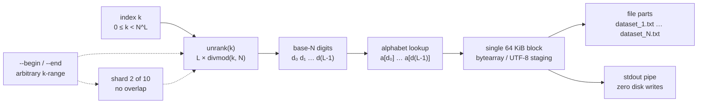
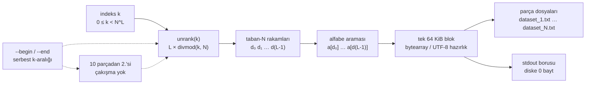

<div align="center">

# Permuter

**Zero-Allocation · O(1) Memory · Radix-Style Combinatorial Unranking & Stream Engine**

*Compute the 10¹⁸-th word of a 10³¹-word space in ~1.4 µs — out of thin air, through a 64 KiB buffer.*


[](https://github.com/xd4rch/Permuter/actions/workflows/tests.yml)


[English](#english) · [Türkçe](#türkçe)

</div>

---

## English

> **The pitch.** Most enumeration tools — wordlist generators included — treat the search space as something to *materialise*: build a list, build a tree, or replay a generator from zero. Permuter is not a wordlist maker: it treats the space as a **number**. Every word of length `L` over an `N`-symbol alphabet is exactly one integer in `[0, N^L)`, and the mapping is a closed-form base-`N` conversion. That single observation removes the memory wall entirely: generation becomes arithmetic, arbitrary index access becomes `O(L)`, and a 64 KiB block buffer is all the RAM the engine ever needs.

### Not a wordlist maker. An enumeration primitive.

Permuter does not *make a wordlist* and then write it. It computes the k-th word **directly from k**, the closed-form inverse of a radix-`N` counter. There is no counter array, no table, no staging file: digits are produced with `divmod`, used as alphabet indices, and written straight into one 64 KiB block.

Picture a mechanical counter with `L` wheels and `N` symbols per wheel. A classic tool either materialises every wheel position or clicks through them one at a time. Permuter reads wheel pattern **#k** without visiting the previous `k-1` patterns, and it streams any `[begin, end)` slice as a radix odometer.

| It is | It is not |
|---|---|
| a stateless `k ↔ base-N` unranking engine | a RAM-hungry list/tree builder |
| an O(1)-memory radix streamer | a GPU brute-force cracker |
| a shardable, resumable range API | a tool that needs `N^L` to fit in memory |

That makes it a primitive for wordlists, fuzz corpora, deterministic test data, sampling, indexing and distributed jobs — the file is just one adapter.

### The memory wall

| Search space | Words | A Python `list` needs* | Permuter |
|---|---:|---:|---:|
| `26⁶` | 308,915,776 | ~16.96 GB | **64 KiB** |
| `26⁸` | 208,827,064,576 | ~11.46 TB | **64 KiB** |
| `26¹⁰` | 141,167,095,653,376 | ~7.75 PB | **64 KiB** |

<sub>*Measured 54.9 bytes/word on CPython 3.14 (list slot + `str` header + payload), see [`benchmark.py`](benchmark.py).</sub>

At `26⁸` the list no longer fits in any machine on Earth. Yet word **#120,000,000,000** does not require the 119,999,999,999 words before it.

```console
$ python benchmark.py          # classical list, hard-capped at 96 MiB
Python list        MemoryError after 0.12 s        1,336,616 words
Permuter   completed in 1.73 s            11,881,376 words   (64 KiB)
```

### One bijection, no state

For an alphabet `a = [a₀ … aₙ₋₁]` the lexicographic index `k` of a word is its base-`N` value:

```
k = d₀·N^(L-1) + d₁·N^(L-2) + … + d(L-1)

word(k) = a[d₀] + a[d₁] + … + a[d(L-1)]
```

`unrank(k, L, a)` performs `L` `divmod` steps and indexes the alphabet directly. There is no tree, no visited set, no precomputed table and no dependence on `N^L`:

```python
>>> from scripts.algorithm import unrank
>>> unrank(10**18, 20, "0123456789abcdefghijklmnopqrstuvwxyz")
'000000007lieexzx4kxs'          # 1.4 µs, O(20)
```

The engine exposes the exact same mapping in every direction and at every scale:

| You want… | Use | Cost |
|---|---|---|
| one specific index | `unrank(k, L, alphabet)` | `O(L)` |
| a lazy stream over a range | `stream_range(L, alphabet, begin, end)` | `O(L)` memory |
| bytes in a file or pipe | `write_range(L, alphabet, begin, end, stream)` | one 64 KiB block |
| a complete file layout | `make_list(L, alphabet, output, -m N)` | one buffer per process |

### Architecture



```
                     ┌─────────────────────────────────────────────┐
  k ──► divmod(k,N)  │  d(L-1) … d1 d0   →   alphabet[d]           │
                     └─────────────────────────────────────────────┘
                                     │
                                     ▼
                     ┌─────────────────────────────────────────────┐
                     │  64 KiB block  →  write()  →  file / stdout │
                     └─────────────────────────────────────────────┘
       O(1) memory · one block · no list · no tree · stateless math
```

**Why it is fast, not just small**

- **Odometer fast path.** Bulk streaming is seeded once by a single `O(L)` unrank, then advances the digit vector by one per word. The canonical per-index `divmod` unrank remains available as `unrank()` and as `engine="divmod"` for byte-for-byte verification.
- **Flat byte buffer.** Single-byte alphabets (`a-z`, `0-9`, hex, base62, …) are written into a preallocated `bytearray`; no `str` object is created per word and the peak traced heap is **70.1 KiB** (buffer included).
- **One syscall per block.** 64 KiB writes against an unbuffered file handle — no hidden second buffer, no per-line `write()` calls.
- **Process-level sharding.** `--workers N` gives every process its own `[begin, end)` slice and its own part file. Zero write contention, zero coordination.
- **Exact integer telemetry.** SI and IEC sizes are computed by integer scaling (`format_bytes`), never by lossy floats.

### Features

- **Zero third-party dependencies.** Standard library only — no `matplotlib`, no `numpy`, no `tqdm`.
- **O(1) memory.** A single 64 KiB block, independent of `N^L`.
- **Random access.** Resolve index `10¹⁸` in ~1.4 µs; no replay.
- **Distributed by design.** `--begin` / `--end` split work across machines with zero overlap.
- **Resumable.** Stop with `Ctrl+C`; partial part files are kept and `--begin` continues exactly where you left off.
- **Pipe mode.** `--stdout` streams to another tool with telemetry on `stderr`, writing 0 bytes to disk.
- **Balanced part files.** `divmod` splitting keeps part sizes within one word of each other; empty parts are never created.
- **Multiprocessing.** One worker per part file, naturally contention-free.
- **Deterministic output.** UTF-8, LF endings, truncating writes — byte counts match the estimate.
- **Library-first.** `unrank`, `stream_range`, `write_range`, `make_list`, `format_bytes` are importable and tested.
- **Cross-platform.** Windows, Linux and macOS; multiprocessing uses the safe `spawn` start method.

### Install

```bash
# Python 3.9+ — nothing to pip install
git clone https://github.com/xd4rch/Permuter.git
cd Permuter
python launcher.py -h
```

The project is a plain directory: copy it anywhere, run it anywhere.

### Quick start

```bash
# 1) Everything: 8 characters over a-z, split into 10 balanced files
python launcher.py -q -l 8 -s abcdefghijklmnopqrstuvwxyz -o dataset -m 10 -y

# 2) One shard (distributed / resume)
python launcher.py -q -l 8 -s abcdefghijklmnopqrstuvwxyz -o shard7 \
    --begin 167061651662 --end 187944358119 -y

# 3) Four cores, four part files
python launcher.py -q -l 6 -s abcdefghijklmnopqrstuvwxyz -o words --workers 4 -y

# 4) Pipe to another tool, never touch the disk
python launcher.py -q -l 6 -s abcdefghijklmnopqrstuvwxyz --stdout -y | head -n 5

# 5) Multi-character symbols
python launcher.py -q -l 3 -s aa bb cc -o words -y

# 6) Word-by-word alphabet: three symbols, not characters
python launcher.py -q -l 2 -s deneme test 123 -o combos -y
```

A run prints its full plan before writing a single byte:

```console
  Alphabet              abcdefghijklmnopqrstuvwxyz  26 symbols
  Word length           8
  Total space           208,827,064,576  26^8
  Index range           [0, 208,827,064,576)
  Words to generate     208,827,064,576
  Estimated size        1.88 TB (SI)  ·  1.71 TiB (IEC)  exact
  Memory footprint      64 KiB fixed buffer  ·  O(1) space
  Output                Permuter_Out  10 parts · dataset_1.txt … dataset_10.txt
  Parallelism           1 process  10 part files
```

**Word-by-word alphabets.** Every token after `-s` is a complete symbol, so `-s deneme test 123` enumerates the three words `deneme`, `test`, `123`: `denemedeneme`, `denemetest`, `deneme123`, `testdeneme`, … A single token is expanded into characters (`-s abc` → a, b, c); pass two or more tokens when each symbol is a whole word.

### CLI reference

| Option | Meaning |
|---|---|
| `-h`, `--help` | Full help screen and examples. |
| `-V`, `--version` | Version. |
| `-w`, `--wizard` | Interactive wizard (default with no arguments). |
| `-q`, `--quick` | Direct mode; can be omitted when target options are present. |
| `-l`, `--length <int>` | Word length `L` (required). |
| `-s`, `--string <symbols...>` | Alphabet. One token → characters (`-s abc` = a,b,c); several tokens → whole-word symbols (`-s deneme test 123` = deneme, test, 123). |
| `-o`, `--out-file <path>` | Output file. **Alias: `-f`, `--file`.** |
| `-c`, `--count <int>` | Number of words to generate (`0` = all). Mutually exclusive with `--end`. |
| `--begin <int>` | First index of the half-open slice `[begin, end)`. Default `0`. |
| `--end <int>` | Exclusive end index. Default `N^L` (or `begin + count`). |
| `-m`, `--multi <int>` | Split the slice into `N` balanced part files. |
| `--workers <int>` | Generate with `N` processes; each owns one part file. |
| `--stdout` | Stream words to stdout; telemetry moves to stderr. |
| `-y`, `--yes` | Skip confirmation (required for unattended runs). |
| `-p`, `--proceed <0\|1\|y\|n>` | Confirmation policy: `0` ask, `1`/`y` accept, `n` decline. |
| `--quiet` | Suppress banner, progress and summary. |
| `--no-color` | Disable ANSI colours (also honours `NO_COLOR`). |

**Exit codes:** `0` success / clean cancel / closed pipe · `1` runtime error · `2` invalid arguments · `130` `Ctrl+C`.

### Output layout

- A name without a directory goes to `Permuter_Out/`.
- A name without an extension gets `.txt` (`dataset` → `dataset_1.txt`).
- Part files are always numbered from `1`: `-o out/data.csv -m 4` → `out/data_1.csv` … `out/data_4.csv`.
- Files are opened in **truncating binary write mode** and encoded as **UTF-8 with LF**, so reruns never append and byte counts are deterministic on every OS.
- `-m` is balanced with `divmod`; if there are fewer words than parts, the surplus parts are skipped instead of creating empty files.

### Distributing 10³¹ words across 10 machines

The space is a half-open integer interval. Splitting it is integer arithmetic:

```python
TOTAL, NODES = 26**8, 10
q, r = divmod(TOTAL, NODES)
start = 0
for node in range(NODES):
    size = q + (1 if node < r else 0)
    end = start + size
    print(f"node{node}: --begin {start} --end {end}")
    start = end
```

For `26⁸ = 208,827,064,576` this yields exactly ten disjoint shards:

| Node | `--begin` | `--end` |
|---|---:|---:|
| 0 | 0 | 20,882,706,458 |
| 1 | 20,882,706,458 | 41,765,412,916 |
| 2 | 41,765,412,916 | 62,648,119,374 |
| 3 | 62,648,119,374 | 83,530,825,832 |
| 4 | 83,530,825,832 | 104,413,532,290 |
| 5 | 104,413,532,290 | 125,296,238,748 |
| 6 | 125,296,238,748 | 146,178,945,205 |
| 7 | 146,178,945,205 | 167,061,651,662 |
| 8 | 167,061,651,662 | 187,944,358,119 |
| 9 | 187,944,358,119 | 208,827,064,576 |

Run one command per machine:

```bash
python launcher.py -q -l 8 -s abcdefghijklmnopqrstuvwxyz \
    -o node0 --begin 0 --end 20882706458 -y
```

Because every shard is computed independently from its own `begin`, there is **no shared state, no lock, no coordination and no overlap**. Concatenating the part files in numeric order reproduces the complete lexicographic space exactly once.

**Resume after a crash.** Partial files are intentionally kept. Read the last complete index (or simply restart the shard with a narrower `--begin`) and continue:

```bash
python launcher.py -q -l 8 -s abcdefghijklmnopqrstuvwxyz \
    -o node0 --begin 12345678901 --end 20882706458 -y
```

Prefer local parallelism? `--workers 4` on one machine gives the same sharding semantics with one process per part file.

### Pipe mode: zero bytes on disk

`--stdout` writes raw words to stdout and moves every diagnostic to stderr, so the pipe is always clean:

```bash
# Preview
python launcher.py -q -l 8 -s abcdefghijklmnopqrstuvwxyz --stdout -y | head -n 20

# Filter while generating (never stores the full space)
python launcher.py -q -l 6 -s abcdefghijklmnopqrstuvwxyz --stdout -y | grep -E '^a'

# Feed a downstream tool
python launcher.py -q -l 5 -s 0123456789 --stdout -y | your-tool --stdin

# Silence telemetry, keep only data
python launcher.py -q -l 4 -s abc --stdout -y 2>/dev/null | wc -l
```

PowerShell:

```powershell
python launcher.py -q -l 6 -s abcdefghijklmnopqrstuvwxyz --stdout -y |
    Select-Object -First 20
```

### Library API

```python
from scripts.algorithm import (
    unrank, stream_range, write_range, make_list,
    total_combinations, estimate_bytes, format_bytes, format_bytes_pair,
)
```

| Function | Description |
|---|---|
| `unrank(index, length, alphabet) -> str` | Stateless `O(L)` lookup; raises `IndexError` outside `[0, N^L)`. |
| `stream_range(length, alphabet, begin=0, end=None)` | Lazy generator over a slice; holds only the current word. |
| `write_range(length, alphabet, begin, end, stream, *, buffer_size=65536, engine="auto", progress=None)` | Writes newline-terminated UTF-8 bytes to any binary stream. |
| `make_list(length, alphabet, output, multi_files=1, begin=0, end=0, *, workers=1)` | Balanced part files; returns `PartResult` records. |
| `total_combinations(length, alphabet) -> int` | Exact `N^L`. |
| `estimate_bytes(length, alphabet, count) -> int` | Exact for uniform-width alphabets. |
| `format_bytes(n, system="SI") -> str` | Pure-Python exact SI/IEC rendering (`1.536 KB`, `1.5 KiB`). |
| `format_bytes_pair(n) -> (str, str)` | Both renderings at once. |

```python
from scripts.algorithm import unrank, stream_range, write_range, format_bytes

# Random access — no enumeration
word = unrank(10**18, 20, "0123456789abcdefghijklmnopqrstuvwxyz")

# A lazy, O(1)-memory slice
for word in stream_range(6, "abc", begin=100, end=110):
    print(word)

# Stream into anything with .write(bytes)
with open("out.txt", "wb", buffering=0) as fh:
    stats = write_range(6, "abcdefghijklmnopqrstuvwxyz", 0, 10**6, fh)
    print(stats.count, format_bytes(stats.bytes_written), f"{stats.words_per_second:,.0f} w/s")
```

`write_range(..., engine="divmod")` forces the strict per-index `divmod` implementation. It produces byte-identical output to the fast path and exists for verification and teaching.

### Benchmarks

Environment: **Windows 11 · Python 3.14.7 · Intel Core i7-14650HX (16C/24T) · NVMe SSD · page cache warm**. Reproduce with `python benchmark.py` (≈3 s).

**Random access** — a `36²⁰ ≈ 1.336 × 10³¹` space:

| Operation | Time | Throughput |
|---|---:|---:|
| `unrank(10¹⁸, 20, base36)` | **1.411 µs** = **0.00141 ms** | 708.5K calls/s |
| Random indices over the same space | 2.230 µs/op | — |

**Streaming throughput** — real UTF-8 file writes, 64 KiB blocks:

| Configuration | Words | Time | Words/s | MB/s |
|---|---:|---:|---:|---:|
| `0-9`, L=6 | 1,000,000 | 146.09 ms | 6.84M | 47.9 |
| `a-z`, L=5 | 1,000,000 | 138.85 ms | **7.20M** | 43.2 |
| `a-z`, L=8 | 1,000,000 | 143.52 ms | 6.97M | **62.7** |
| `0-9a-z`, L=8 | 1,000,000 | 143.81 ms | 6.95M | 62.6 |
| `0-9a-zA-Z`, L=6 | 1,000,000 | 139.38 ms | 7.17M | 50.2 |

**Constant memory** — `tracemalloc` around 1,000,000 generated words:

| Metric | Value |
|---|---:|
| Engine buffer | 65,536 bytes (64 KiB) |
| Peak traced heap | **70.1 KiB** (1.09× the buffer) |
| Words generated | 1,000,000 |
| Memory growth with `N^L` | **none** |

**Classical list vs. engine** — the same `26⁵ = 11,881,376`-word space:

| Approach | Outcome | Words held | Memory |
|---|---|---|---:|
| Python `list` | `MemoryError` after 0.12 s | 1,336,616 (11.25%) | 96 MiB cap |
| Permuter | completed in 1.73 s · 6.87M words/s · 41.2 MB/s | 11,881,376 (100%) | **64 KiB** |

**Projection** — measured 54.9 bytes/word of list overhead:

| Space | List-based RAM | Permuter |
|---|---:|---:|
| `26⁶` (308,915,776) | 16.955 GB | 64 KiB |
| `26⁸` (208,827,064,576) | 11.461 TB | 64 KiB |
| `26¹⁰` (141,167,095,653,376) | 7.748 PB | 64 KiB |

> Numbers are from one run on the machine above and will vary with CPU, filesystem and cache state. The invariant that matters is not the exact MB/s — it is that **memory stays at 64 KiB while the space grows without bound**.

### Tests

```bash
python -m pytest tests -q
# 76 passed, 19 subtests passed in 3.6s

python -m unittest discover -s tests -v
# Ran 76 tests … OK
```

Coverage highlights: first/last/boundary indices, multi-character and Unicode alphabets, full-space equality against `itertools.product`, arbitrary `[begin, end)` shard recombination, balanced `divmod` partitioning, `-m` part completeness and truncation, `--stdout` purity (no data leakage from telemetry), `--workers` equivalence with sequential output, non-interactive confirmation refusal, error/exit-code handling, `-f`/`-o` aliases, and a `tracemalloc` bound proving constant memory.

### Design notes

- **Canonical unrank + incremental fast path.** `unrank` is the definition; the odometer is an optimization that evaluates the same bijection one step at a time. Tests force both engines and compare bytes.
- **Two buffer strategies.** Single-byte ASCII alphabets use a flat `bytearray` (true 64 KiB, ~70 KiB traced peak). Unicode and multi-character alphabets use a 64 KiB-payload staging list and encode at flush; memory remains `O(1)` and independent of `N^L`.
- **Unbuffered files.** Part files are opened with `buffering=0` so the engine's 64 KiB block is the only buffer — on some systems `open()` would otherwise allocate a hidden 128 KiB buffer.
- **No matplotlib.** `format_bytes` implements exact integer SI/IEC scaling in pure Python.
- **Spawned processes.** `multiprocessing` uses the `spawn` context; each worker owns one part file and one stop event, so `Ctrl+C` never leaves overlapping writers.

### FAQ

**Why 64 KiB?** It amortises syscalls while staying small enough to fit comfortably in L2 cache and to keep peak memory microscopic. `write_range(buffer_size=...)` lets library users tune it.

**Is the output lexicographic?** Yes. Index `0` is `a₀` repeated `L` times; index `N^L − 1` is `aₙ₋₁` repeated `L` times.

**Can I fetch just one word?** `unrank(k, L, alphabet)` or `stream_range(L, alphabet, k, k + 1)`.

**Why do files have a `_1` suffix?** Uniform naming for 1..N part files. `-o dataset` always means `dataset_1.txt`, `dataset_2.txt`, … — no ambiguity between a single run and a multi-part run.

**Why is `-y` required in scripts?** Non-interactive stdin cannot answer the confirmation prompt. The tool refuses to start silently; pass `-y`/`--yes` (or `-p y`) to confirm.

**Does it write to disk in `--stdout` mode?** No. Output directories are never created, and telemetry goes to stderr.

**Can it handle huge `L`?** Yes. `unrank` is `O(L)` and the range arithmetic is arbitrary-precision; only the line length grows.

**Is it a password cracker?** No. It is a deterministic combinatorial unranking engine; wordlists are one output, not the product. Use it for test corpora, fuzz seeds and shardable datasets — only on data you are allowed to process.

**How do I cite the speed claim?** Run `python benchmark.py` on your hardware; the script prints its own environment and numbers.

### Contributing

Issues and PRs are welcome — see [CONTRIBUTING.md](CONTRIBUTING.md). Run `python -m unittest discover -s tests -v` before opening a PR.

### License

MIT — see [`LICENSE`](LICENSE).

---

## Türkçe

> **Kısaca.** Çoğu numaralandırma aracı — kelime listesi üreticileri dahil — arama uzayını *somutlaştırır*: liste kurar, ağaç kurar ya da bir üreteci sıfırdan tekrar oynatır. Permuter bir kelime listesi üreticisi değildir: uzayı bir **sayı** olarak görür. `N` sembollü bir alfabede `L` uzunluğundaki her kelime, `[0, N^L)` aralığındaki tam olarak bir tamsayıya karşılık gelir ve bu eşleme kapalı formda bir taban-`N` dönüşümüdür. Bu tek gözlem bellek duvarını ortadan kaldırır: üretim aritmetiğe, rastgele indeks erişimi `O(L)`'ye dönüşür ve motorun ihtiyaç duyduğu tüm RAM tek bir 64 KiB blok tamponudur.

### Kelime listesi üreticisi değil; bir numaralandırma ilkeli.

Permuter önce bir kelime listesi *üretip* sonra yazmaz. `k`. kelimeyi **doğrudan `k`'dan** hesaplar; bu, radix-`N` sayacının kapalı formdaki tersidir. Sayacı dizi olarak tutmaz, tablo yoktur, ara dosya yoktur: rakamlar `divmod` ile üretilir, alfabe indeksi olarak kullanılır ve doğrudan tek bir 64 KiB bloğa yazılır.

`L` tekerlekli, her tekerleğinde `N` sembol bulunan mekanik bir sayaç düşünün. Klasik araç ya tüm tekerlek konumlarını somutlaştırır ya da baştan tek tek tıklar. Permuter, önceki `k-1` deseni ziyaret etmeden **#k** desenini okur; herhangi bir `[begin, end)` dilimini radix odometresi olarak akıtır.

| Şudur | Şu değildir |
|---|---|
| durumsuz bir `k ↔ taban-N` unrank motoru | RAM'i şişiren liste/ağaç üreticisi |
| O(1) bellekli radix akış motoru | GPU şifre kırıcı |
| parçalanabilir, devam ettirilebilir aralık API'si | `N^L`'nin belleğe sığmasını gerektiren araç |

Bu yüzden kelime listeleri, fuzz veri kümeleri, belirlenimci test verileri, örnekleme, indeksleme ve dağıtık işler için bir ilkeldir — dosya yalnızca bir adaptördür.

### Bellek duvarı

| Arama uzayı | Kelime sayısı | Klasik Python `list` | Permuter |
|---|---:|---:|---:|
| `26⁶` | 308.915.776 | ~16,96 GB | **64 KiB** |
| `26⁸` | 208.827.064.576 | ~11,46 TB | **64 KiB** |
| `26¹⁰` | 141.167.095.653.376 | ~7,75 PB | **64 KiB** |

<sub>*CPython 3.14 üzerinde kelime başına 54,9 bayt ölçüldü (liste yuvası + `str` başlığı + veri); ayrıntılar [`benchmark.py`](benchmark.py).</sub>

`26⁸` boyutunda liste artık dünyadaki hiçbir makineye sığmaz. Yine de **120.000.000.000. kelimeyi** bulmak için ondan önceki 119.999.999.999 kelimeyi üretmek gerekmez.

```console
$ python benchmark.py          # klasik liste, 96 MiB sert bellek sınırı
Python list        MemoryError after 0.12 s        1.336.616 kelime
Permuter   completed in 1.73 s            11.881.376 kelime   (64 KiB)
```

### Tek bir eşleme, sıfır durum

`a = [a₀ … aₙ₋₁]` alfabesi için bir kelimenin sözlük sırasına göre indeksi `k`, onun taban-`N` değeridir:

```
k = d₀·N^(L-1) + d₁·N^(L-2) + … + d(L-1)

kelime(k) = a[d₀] + a[d₁] + … + a[d(L-1)]
```

`unrank(k, L, a)` yalnızca `L` adet `divmod` adımı yapar ve alfabeye doğrudan indeksler. Ağaç yok, ziyaret edilen küme yok, önceden hesaplanmış tablo yok; hiçbir şey `N^L`'ye bağlı değil:

```python
>>> from scripts.algorithm import unrank
>>> unrank(10**18, 20, "0123456789abcdefghijklmnopqrstuvwxyz")
'000000007lieexzx4kxs'          # 1,4 µs, O(20)
```

Motor aynı eşlemeyi her yönde ve her ölçekte sunar:

| İhtiyacınız | Kullanın | Maliyet |
|---|---|---|
| tek bir indeks | `unrank(k, L, alfabe)` | `O(L)` |
| aralık üzerinde tembel akış | `stream_range(L, alfabe, begin, end)` | `O(L)` bellek |
| dosya veya boruya bayt | `write_range(...)` | tek 64 KiB blok |
| eksiksiz dosya düzeni | `make_list(L, alfabe, çıktı, -m N)` | süreç başına tek tampon |

### Mimari



```
                     ┌─────────────────────────────────────────────┐
  k ──► divmod(k,N)  │  d(L-1) … d1 d0   →   alfabe[d]             │
                     └─────────────────────────────────────────────┘
                                     │
                                     ▼
                     ┌─────────────────────────────────────────────┐
                     │  64 KiB blok  →  write()  →  dosya / stdout │
                     └─────────────────────────────────────────────┘
       O(1) bellek · tek blok · liste yok · ağaç yok · durumsuz matematik
```

**Yalnızca küçük değil, aynı zamanda hızlı**

- **Odometre hızlı yolu.** Toplu akış, tek bir `O(L)` unrank ile tohumlanır; ardından rakam vektörü kelime başına bir ilerletilir. Kanonik indeks-başına `divmod` unrank'ı `unrank()` ve doğrulama için `engine="divmod"` olarak korunur.
- **Düz bayt tamponu.** Tek baytlık alfabeler (`a-z`, `0-9`, hex, base62, …) önceden ayrılmış bir `bytearray`'ye yazılır; kelime başına `str` nesnesi oluşmaz ve ölçülen tepe bellek **70,1 KiB**'tir (tampon dahil).
- **Blok başına tek sistem çağrısı.** Tamponsuz dosya tanıtıcısı üzerine 64 KiB yazım — gizli ikinci tampon yok, satır başına `write()` yok.
- **Süreç düzeyinde parçalama.** `--workers N`, her sürece kendi `[begin, end)` dilimini ve kendi parça dosyasını verir. Yazma çakışması yok, koordinasyon yok.
- **Tam tamsayı telemetrisi.** SI ve IEC boyutları kayıplı float yerine tamsayı ölçeklemesiyle (`format_bytes`) hesaplanır.

### Özellikler

- **Sıfır üçüncü taraf bağımlılığı.** Yalnızca standart kütüphane — `matplotlib` yok, `numpy` yok, `tqdm` yok.
- **O(1) bellek.** `N^L`'den bağımsız, tek bir 64 KiB blok.
- **Rastgele erişim.** `10¹⁸` indeksini ~1,4 µs'de çözer; baştan oynatma yok.
- **Tasarımı gereği dağıtık.** `--begin` / `--end` işi makineler arasında sıfır çakışmayla böler.
- **Kaldığı yerden devam.** `Ctrl+C` ile durdurun; kısmi parça dosyaları korunur ve `--begin` tam kaldığınız yerden sürdürür.
- **Boru modu.** `--stdout` başka bir araca akış verir, telemetri `stderr`'e gider, diske 0 bayt yazılır.
- **Dengeli parça dosyaları.** `divmod` bölümlemesi parça boyutlarını bir kelimeden fazla farklılaştırmaz; boş parça hiç oluşturulmaz.
- **Çoklu süreç.** Her parça dosyası için bir süreç; doğal olarak çakışmasız.
- **belirlenimci çıktı.** UTF-8, LF satır sonu, kırpan yazma — bayt sayısı tahminle birebir uyuşur.
- **Kütüphane öncelikli.** `unrank`, `stream_range`, `write_range`, `make_list`, `format_bytes` içe aktarılabilir ve test edilmiştir.
- **Platformlar arası.** Windows, Linux ve macOS; çoklu süreç güvenli `spawn` yöntemini kullanır.

### Kurulum

```bash
# Python 3.9+ — pip ile kurulacak bir şey yok
git clone https://github.com/xd4rch/Permuter.git
cd Permuter
python launcher.py -h
```

Proje düz bir dizindir: istediğiniz yere kopyalayın, istediğiniz yerde çalıştırın.

### Hızlı başlangıç

```bash
# 1) Tamamı: a-z üzerinde 8 karakter, 10 dengeli dosyaya bölünmüş
python launcher.py -q -l 8 -s abcdefghijklmnopqrstuvwxyz -o dataset -m 10 -y

# 2) Tek parça (dağıtık hesaplama / devam)
python launcher.py -q -l 8 -s abcdefghijklmnopqrstuvwxyz -o shard7 \
    --begin 167061651662 --end 187944358119 -y

# 3) Dört çekirdek, dört parça dosyası
python launcher.py -q -l 6 -s abcdefghijklmnopqrstuvwxyz -o words --workers 4 -y

# 4) Diske hiç dokunmadan başka bir araca aktar
python launcher.py -q -l 6 -s abcdefghijklmnopqrstuvwxyz --stdout -y | head -n 5

# 5) Çok karakterli semboller
python launcher.py -q -l 3 -s aa bb cc -o words -y

# 6) Kelime kelime alfabe: karakterler değil, üç sembol
python launcher.py -q -l 2 -s deneme test 123 -o combos -y
```

Çalışma, tek bayt yazmadan önce tüm planı ekrana basar:

```console
  Alphabet              abcdefghijklmnopqrstuvwxyz  26 symbols
  Word length           8
  Total space           208,827,064,576  26^8
  Index range           [0, 208,827,064,576)
  Words to generate     208,827,064,576
  Estimated size        1.88 TB (SI)  ·  1.71 TiB (IEC)  exact
  Memory footprint      64 KiB fixed buffer  ·  O(1) space
  Output                Permuter_Out  10 parts · dataset_1.txt … dataset_10.txt
  Parallelism           1 process  10 part files
```

**Kelime kelime alfabeler.** `-s` sonrasındaki her belirteç tam bir semboldür; `-s deneme test 123` üç kelimeyi (`deneme`, `test`, `123`) numaralandırır: `denemedeneme`, `denemetest`, `deneme123`, `testdeneme`, … Tek belirteç karakterlere ayrılır (`-s abc` → a, b, c); her sembol tam bir kelime olacaksa iki veya daha fazla belirteç verin.

### Komut satırı başvurusu

| Seçenek | Anlamı |
|---|---|
| `-h`, `--help` | Tüm yardım ekranı ve örnekler. |
| `-V`, `--version` | Sürüm. |
| `-w`, `--wizard` | Etkileşimli sihirbaz (argümansız varsayılan). |
| `-q`, `--quick` | Doğrudan mod; hedef seçenekleri verildiğinde atlanabilir. |
| `-l`, `--length <int>` | Kelime uzunluğu `L` (zorunlu). |
| `-s`, `--string <semboller...>` | Alfabe. Tek belirteç → karakterler (`-s abc` = a,b,c); çok belirteç → tam kelime sembolleri (`-s deneme test 123` = deneme, test, 123). |
| `-o`, `--out-file <yol>` | Çıktı dosyası. **Takma ad: `-f`, `--file`.** |
| `-c`, `--count <int>` | Üretilecek kelime sayısı (`0` = tümü). `--end` ile birlikte kullanılamaz. |
| `--begin <int>` | `[begin, end)` diliminin ilk indeksi. Varsayılan `0`. |
| `--end <int>` | Dilimin bitiş indeksi (hariç). Varsayılan `N^L` (veya `begin + count`). |
| `-m`, `--multi <int>` | Dilimi `N` dengeli parça dosyasına böl. |
| `--workers <int>` | `N` süreçle üret; her süreç bir parça dosyasına yazar. |
| `--stdout` | Kelimeleri stdout'a akıt; telemetri stderr'e taşınır. |
| `-y`, `--yes` | Onayı atla (gözetimsiz çalıştırmalar için zorunlu). |
| `-p`, `--proceed <0\|1\|y\|n>` | Onay politikası: `0` sor, `1`/`y` kabul, `n` reddet. |
| `--quiet` | Afiş, ilerleme ve özeti bastır. |
| `--no-color` | ANSI renklerini kapat (`NO_COLOR` da dikkate alınır). |

**Çıkış kodları:** `0` başarı / temiz iptal / kapanan boru · `1` çalışma zamanı hatası · `2` geçersiz argüman · `130` `Ctrl+C`.

### Çıktı düzeni

- Dizin içermeyen ad `Permuter_Out/` altına yazılır.
- Uzantısız ad `.txt` alır (`dataset` → `dataset_1.txt`).
- Parça dosyaları her zaman `1`'den numaralanır: `-o out/data.csv -m 4` → `out/data_1.csv` … `out/data_4.csv`.
- Dosyalar **kırpan ikili yazma kipinde** açılır ve **UTF-8 + LF** olarak kodlanır; yeniden çalıştırma asla ekleme yapmaz ve bayt sayısı her işletim sisteminde belirlenimcidir.
- `-m` ile bölme `divmod` kullanır; kelime sayısı parça sayısından azsa boş dosya üretmek yerine fazla parçalar atlanır.

### 10³¹ kelimeyi 10 makineye dağıtmak

Uzay, yarım açık bir tamsayı aralığıdır. Bölmek saf tamsayı aritmetiğidir:

```python
TOTAL, NODES = 26**8, 10
q, r = divmod(TOTAL, NODES)
start = 0
for node in range(NODES):
    size = q + (1 if node < r else 0)
    end = start + size
    print(f"node{node}: --begin {start} --end {end}")
    start = end
```

`26⁸ = 208.827.064.576` için bu tam olarak on ayrık parça verir:

| Düğüm | `--begin` | `--end` |
|---|---:|---:|
| 0 | 0 | 20.882.706.458 |
| 1 | 20.882.706.458 | 41.765.412.916 |
| 2 | 41.765.412.916 | 62.648.119.374 |
| 3 | 62.648.119.374 | 83.530.825.832 |
| 4 | 83.530.825.832 | 104.413.532.290 |
| 5 | 104.413.532.290 | 125.296.238.748 |
| 6 | 125.296.238.748 | 146.178.945.205 |
| 7 | 146.178.945.205 | 167.061.651.662 |
| 8 | 167.061.651.662 | 187.944.358.119 |
| 9 | 187.944.358.119 | 208.827.064.576 |

Her makinede tek komut:

```bash
python launcher.py -q -l 8 -s abcdefghijklmnopqrstuvwxyz \
    -o node0 --begin 0 --end 20882706458 -y
```

Her parça kendi `begin` değerinden bağımsız hesaplandığı için **paylaşılan durum, kilit, koordinasyon ve çakışma yoktur**. Parça dosyalarını numara sırasına göre birleştirmek, tam sözlük sırasındaki uzayı bir kez ve eksiksiz üretir.

**Çökme sonrası devam.** Kısmi dosyalar bilinçli olarak korunur. Son tamamlanan indeksi okuyun (veya parçayı daha dar bir `--begin` ile yeniden başlatın) ve sürdürün:

```bash
python launcher.py -q -l 8 -s abcdefghijklmnopqrstuvwxyz \
    -o node0 --begin 12345678901 --end 20882706458 -y
```

Yerel paralellik mi istiyorsunuz? Tek makinede `--workers 4`, aynı parçalama anlamını parça dosyası başına bir süreçle verir.

### Boru modu: diskte sıfır bayt

`--stdout` ham kelimeleri stdout'a yazar, tüm tanılama çıktısını stderr'e taşır; böylece boru her zaman temizdir:

```bash
# Önizleme
python launcher.py -q -l 8 -s abcdefghijklmnopqrstuvwxyz --stdout -y | head -n 20

# Üretirken süz (tüm uzayı asla saklamaz)
python launcher.py -q -l 6 -s abcdefghijklmnopqrstuvwxyz --stdout -y | grep -E '^a'

# Alt araca besle
python launcher.py -q -l 5 -s 0123456789 --stdout -y | araciniz --stdin

# Telemetriyi sustur, yalnızca veriyi tut
python launcher.py -q -l 4 -s abc --stdout -y 2>/dev/null | wc -l
```

PowerShell:

```powershell
python launcher.py -q -l 6 -s abcdefghijklmnopqrstuvwxyz --stdout -y |
    Select-Object -First 20
```

### Kütüphane API'si

```python
from scripts.algorithm import (
    unrank, stream_range, write_range, make_list,
    total_combinations, estimate_bytes, format_bytes, format_bytes_pair,
)
```

| Fonksiyon | Açıklama |
|---|---|
| `unrank(index, length, alphabet) -> str` | Durumsuz `O(L)` arama; `[0, N^L)` dışında `IndexError`. |
| `stream_range(length, alphabet, begin=0, end=None)` | Dilim üzerinde tembel üreteç; yalnızca geçerli kelimeyi tutar. |
| `write_range(length, alphabet, begin, end, stream, *, buffer_size=65536, engine="auto", progress=None)` | Herhangi bir ikili akışa LF ile biten UTF-8 baytları yazar. |
| `make_list(length, alphabet, output, multi_files=1, begin=0, end=0, *, workers=1)` | Dengeli parça dosyaları; `PartResult` kayıtları döndürür. |
| `total_combinations(length, alphabet) -> int` | Tam `N^L`. |
| `estimate_bytes(length, alphabet, count) -> int` | Tek genişlikli alfabelerde tam. |
| `format_bytes(n, system="SI") -> str` | Saf Python, tam SI/IEC gösterimi (`1.536 KB`, `1.5 KiB`). |
| `format_bytes_pair(n) -> (str, str)` | İki gösterimi birlikte verir. |

```python
from scripts.algorithm import unrank, stream_range, write_range, format_bytes

# Rastgele erişim — numaralandırma yok
word = unrank(10**18, 20, "0123456789abcdefghijklmnopqrstuvwxyz")

# Tembel, O(1) bellekli dilim
for word in stream_range(6, "abc", begin=100, end=110):
    print(word)

# .write(bytes) olan her şeye akıt
with open("out.txt", "wb", buffering=0) as fh:
    stats = write_range(6, "abcdefghijklmnopqrstuvwxyz", 0, 10**6, fh)
    print(stats.count, format_bytes(stats.bytes_written), f"{stats.words_per_second:,.0f} w/s")
```

`write_range(..., engine="divmod")` katı indeks-başına `divmod` uygulamasını zorlar. Hızlı yol ile bayt bayt aynı çıktıyı üretir; doğrulama ve öğretim için vardır.

### Kıyaslama

Ortam: **Windows 11 · Python 3.14.7 · Intel Core i7-14650HX (16C/24T) · NVMe SSD · sayfa önbelleği sıcak**. `python benchmark.py` ile yeniden üretin (≈3 sn).

**Rastgele erişim** — `36²⁰ ≈ 1,336 × 10³¹` boyutunda uzay:

| İşlem | Süre | Hız |
|---|---:|---:|
| `unrank(10¹⁸, 20, base36)` | **1,411 µs** = **0,00141 ms** | 708.500 çağrı/sn |
| Aynı uzayda rastgele indeksler | 2,230 µs/işlem | — |

**Akış hızı** — gerçek UTF-8 dosya yazımı, 64 KiB bloklar:

| Yapılandırma | Kelime | Süre | Kelime/sn | MB/sn |
|---|---:|---:|---:|---:|
| `0-9`, L=6 | 1.000.000 | 146,09 ms | 6,84M | 47,9 |
| `a-z`, L=5 | 1.000.000 | 138,85 ms | **7,20M** | 43,2 |
| `a-z`, L=8 | 1.000.000 | 143,52 ms | 6,97M | **62,7** |
| `0-9a-z`, L=8 | 1.000.000 | 143,81 ms | 6,95M | 62,6 |
| `0-9a-zA-Z`, L=6 | 1.000.000 | 139,38 ms | 7,17M | 50,2 |

**Sabit bellek** — 1.000.000 kelime üretimi sırasında `tracemalloc`:

| Ölçüm | Değer |
|---|---:|
| Motor tamponu | 65.536 bayt (64 KiB) |
| Ölçülen tepe bellek | **70,1 KiB** (tamponun 1,09 katı) |
| Üretilen kelime | 1.000.000 |
| `N^L` ile bellek artışı | **yok** |

**Klasik liste ile motor** — aynı `26⁵ = 11.881.376` kelimelik uzay:

| Yaklaşım | Sonuç | Tutulan kelime | Bellek |
|---|---|---|---:|
| Python `list` | 0,12 sn sonra `MemoryError` | 1.336.616 (%11,25) | 96 MiB sınır |
| Permuter | 1,73 sn'de tamamlandı · 6,87M kelime/sn · 41,2 MB/sn | 11.881.376 (%100) | **64 KiB** |

**İzdüşüm** — kelime başına 54,9 bayt liste yükü ölçüldü:

| Uzay | Liste tabanlı RAM | Permuter |
|---|---:|---:|
| `26⁶` (308.915.776) | 16,955 GB | 64 KiB |
| `26⁸` (208.827.064.576) | 11,461 TB | 64 KiB |
| `26¹⁰` (141.167.095.653.376) | 7,748 PB | 64 KiB |

> Sayılar yukarıdaki makinede tek bir çalıştırmadan alınmıştır; CPU, dosya sistemi ve önbellek durumuna göre değişir. Önemli olan tam MB/sn değil, **uzay sınırsız büyürken belleğin 64 KiB'te sabit kalmasıdır**.

### Testler

```bash
python -m pytest tests -q
# 76 passed, 19 subtests passed in 3.6s

python -m unittest discover -s tests -v
# Ran 76 tests … OK
```

Kapsam: ilk/son/sınır indeksleri, çok karakterli ve Unicode alfabeler, `itertools.product` ile tam uzay eşitliği, rastgele `[begin, end)` parçalarının birleşimi, dengeli `divmod` bölümlemesi, `-m` parça eksiksizliği ve kırpma, `--stdout` saflığı (telemetri sızıntısı yok), `--workers` ile sıralı çıktı denkliği, etkileşimsiz onay reddi, hata/çıkış kodu yönetimi, `-f`/`-o` takma adları ve sabit belleği kanıtlayan `tracemalloc` sınırı.

### Tasarım notları

- **Kanonik unrank + artımlı hızlı yol.** `unrank` tanımdır; odometre aynı eşlemeyi birer birer değerlendiren bir eniyileştirmedir. Testler iki motoru da zorlar ve baytları karşılaştırır.
- **İki tampon stratejisi.** Tek baytlık ASCII alfabeleri düz `bytearray` kullanır (gerçek 64 KiB, ~70 KiB tepe). Unicode ve çok karakterli alfabeler 64 KiB yüklük hazırlık listesi kullanıp boşaltmada kodlar; bellek `O(1)` ve `N^L`'den bağımsız kalır.
- **Tamponsuz dosyalar.** Parça dosyaları `buffering=0` ile açılır; böylece motorun 64 KiB bloğu tek tampondur — bazı sistemlerde `open()` aksi hâlde gizli bir 128 KiB tampon ayırırdı.
- **matplotlib yok.** `format_bytes`, tam tamsayı SI/IEC ölçeklemesini saf Python ile uygular.
- **Spawn süreçleri.** `multiprocessing` `spawn` bağlamını kullanır; her işçi bir parça dosyasına ve bir durdurma olayına sahiptir, `Ctrl+C` çakışan yazıcı bırakmaz.

### SSS

**Neden 64 KiB?** Sistem çağrılarını amortize ederken L2 önbelleğe rahatça sığacak ve tepe belleği mikroskobik tutacak kadar küçüktür. `write_range(buffer_size=...)` ile kütüphane kullanıcıları ayarlayabilir.

**Çıktı sözlük sırasında mı?** Evet. `0` indeksi `a₀`'ın `L` kez tekrarıdır; `N^L − 1` indeksi `aₙ₋₁`'in `L` kez tekrarıdır.

**Tek bir kelime alabilir miyim?** `unrank(k, L, alfabe)` veya `stream_range(L, alfabe, k, k + 1)`.

**Dosyalarda neden `_1` soneki var?** 1..N parça dosyası için tek tip adlandırma. `-o dataset` her zaman `dataset_1.txt`, `dataset_2.txt`, … anlamına gelir; tek çalıştırma ile çok parçalı çalıştırma arasında belirsizlik yoktur.

**Betiklerde neden `-y` zorunlu?** Etkileşimsiz stdin onay istemini yanıtlayamaz. Araç sessizce başlamayı reddeder; onaylamak için `-y`/`--yes` (veya `-p y`) verin.

**`--stdout` modunda diske yazıyor mu?** Hayır. Çıktı dizinleri hiç oluşturulmaz ve telemetri stderr'e gider.

**Çok büyük `L` ile çalışır mı?** Evet. `unrank` `O(L)`'dir ve aralık aritmetiği keyfî hassasiyetlidir; yalnızca satır uzunluğu büyür.

**Bu bir şifre kırıcı mı?** Hayır. Belirlenimci bir kombinatoryal unrank motorudur; kelime listesi yalnızca çıktılardan biridir, ürünün kendisi değildir. Test verileri, fuzz tohumları ve parçalanabilir veri kümeleri için kullanın; yalnızca işlemeye yetkiniz olan verilerde ve sorumlu biçimde.

**Hız iddiasını nasıl doğrularım?** `python benchmark.py` çalıştırın; betik kendi ortamını ve sayılarını yazdırır.

### Katkı

Issue ve PR'lar memnuniyetle karşılanır — bkz. [CONTRIBUTING.md](CONTRIBUTING.md). PR açmadan önce `python -m unittest discover -s tests -v` çalıştırın.

### Lisans

MIT — bkz. [`LICENSE`](LICENSE).
